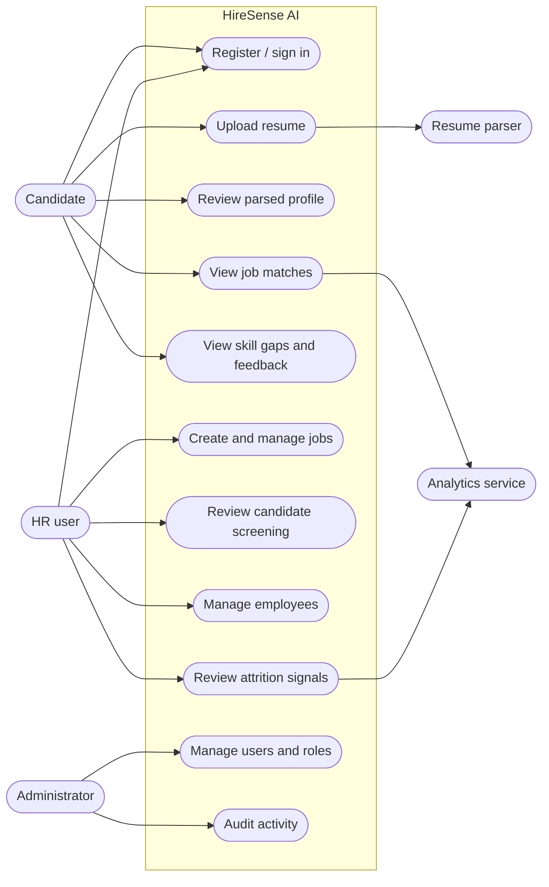
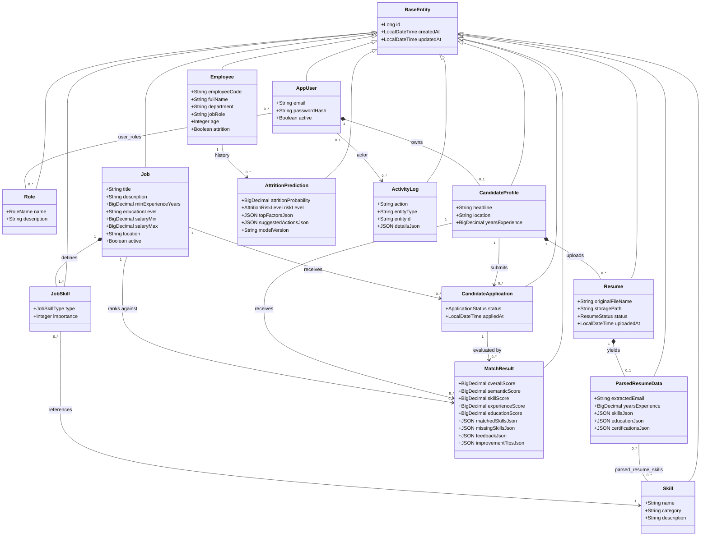
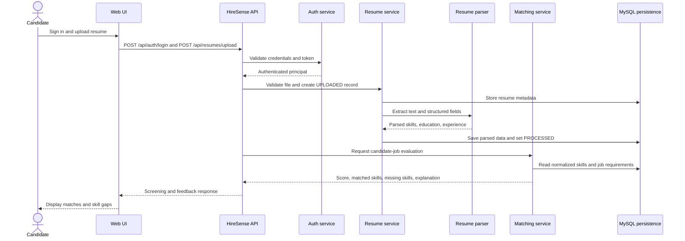
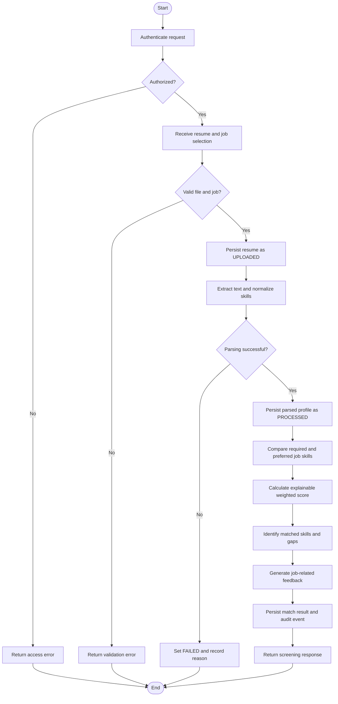
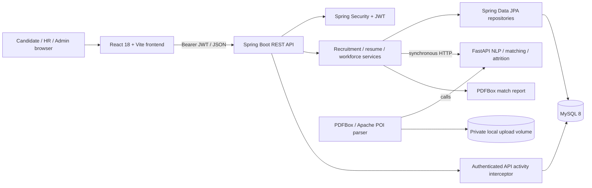
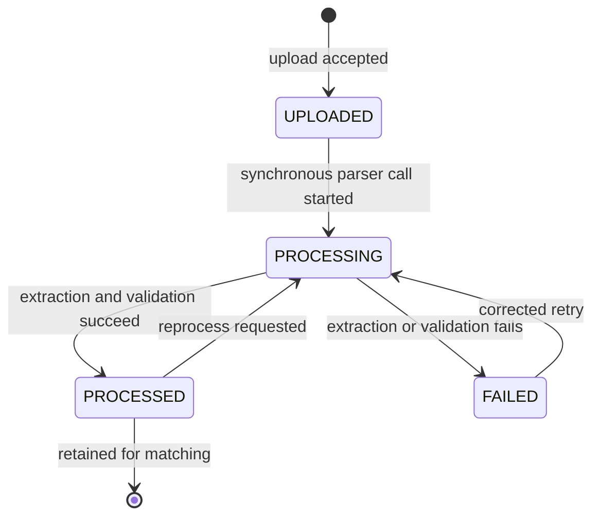
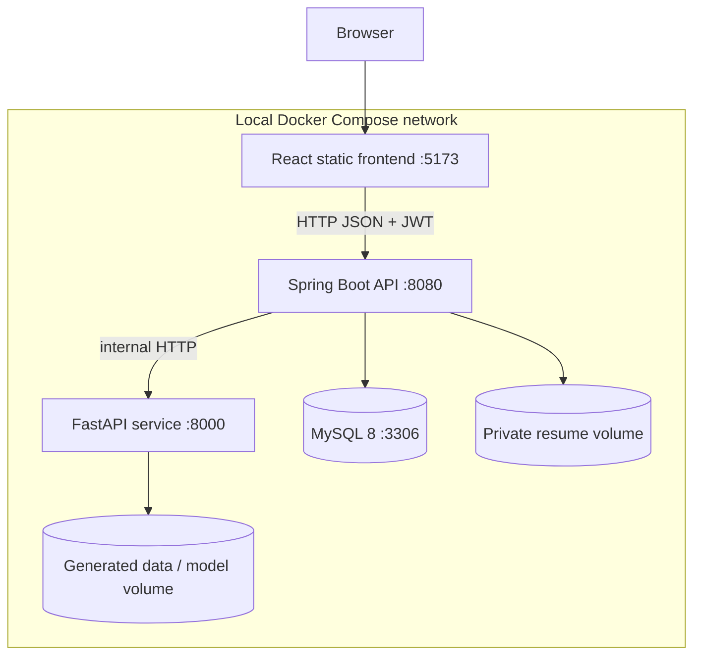

# HireSense AI — Academic Design Report

## 1. Scope and evidence boundary

HireSense is implemented as a full-stack recruitment and workforce-analytics application: Spring Boot/JPA and MySQL, JWT/API security, PDF/DOCX resume parsing, a FastAPI NLP/matching/attrition service, React role-based pages, match PDF reports, admin audit records, and local Docker Compose configuration. This report documents the current implementation and verified evidence; it distinguishes the local Compose setup from production architecture recommendations.

**Verification snapshot (2 October 2026):** 4 backend JUnit tests and 4 Python tests passed; the Vite production build succeeded with a large-chunk warning. A live MySQL smoke test exercised candidate login/profile, PDF upload and parsing, match/section feedback/PDF, application tracking, HR ranking and attrition dashboard, and admin stats/audit. Docker Compose itself could not be run because Docker is unavailable in the build sandbox. The synthetic attrition model is not validated for real employment decisions.

## 2. System requirements and actors

- **Candidate:** registers, uploads a resume, reviews parsed information, sees job matches, and receives skill-gap feedback.
- **HR user:** creates jobs, manages employees, reviews explainable candidate matches, and reviews attrition signals.
- **Administrator:** manages roles, accounts, configuration, and audit access.
- **HireSense services:** authenticate requests, parse resumes, normalize skills, calculate explainable matches, and produce workforce-analytics signals.

## 3. UML-style system diagrams

### 3.1 Use-case diagram



### 3.2 Class diagram



### 3.3 Sequence diagram — resume-to-match flow



### 3.4 Activity diagram — screening and feedback



### 3.5 Component diagram — implemented local stack



### 3.6 State-machine diagram — resume lifecycle



### 3.7 Deployment diagram — provided Docker Compose profile



The diagram reflects the supplied local Compose topology, not hardened production networking. Production should terminate TLS, encrypt persistent storage, isolate databases and uploads, configure backup/retention, and apply least-privilege access. No queue/background worker or object-store service is included in the current Compose profile.

## 4. Verification matrix (2 October 2026)

Observed results are separated from design-only expectations. The live smoke test used a local MySQL 8 database, synthetic seed accounts/records, the local FastAPI service, and a generated synthetic PDF resume. It is integration evidence, not a production-readiness or model-validity claim.

| ID | Module | Verification | Observed result | Status |
|---|---|---|---|---|
| TC-AUTH-01 | Authentication | Candidate/HR/Admin seeded logins; candidate profile and role token | Authenticated requests returned HTTP 200 and the candidate profile matched the logged-in account | Passed |
| TC-AUTH-02 | Authentication | Invalid password and inactive account rejection | Not exercised in the final smoke test | Pending |
| TC-RES-01 | Resume parsing | Upload generated PDF with skills, education, certifications, and experience | HTTP 201; resume status `PROCESSED`; extracted data persisted and was accepted for matching | Passed |
| TC-RES-02 | Resume parsing | Corrupt, unsupported, or >5 MB file | Not exercised in this final smoke test | Pending |
| TC-MAT-01 | Matching/report | Candidate resume vs seeded job; inspect saved components, skills, section feedback, and report | Match returned HTTP 200 with score/components and `Skills`, `Education`, `Certifications` feedback; PDF endpoint returned HTTP 200 and a `%PDF` payload | Passed |
| TC-MAT-02 | Fairness | Paired resumes differing only in name/demographic/photo attributes | Source removes identity/demographic terms and match service excludes employee demographics, but no paired counterfactual outcome test was run | Partial; formal fairness testing remains |
| TC-JOB-01 | Job management | HR creates a job with required and preferred skill names | MockMvc integration test persisted and returned both skill types | Passed |
| TC-APP-01 | Applications/ranking | Candidate applies; candidate tracking and HR-ranked candidates | Live application returned `SUBMITTED`; tracking and HR ranking both returned HTTP 200 | Passed |
| TC-EMP-01 | Employee management | Read seeded HR employee directory | HTTP 200; 20 records returned for the default page | Partial; create/update/import/deactivate not smoke-tested |
| TC-EMP-02 | Authorization | Candidate attempts employee directory access | MockMvc test returned HTTP 403 | Passed |
| TC-ATT-01 | Attrition analytics | Predict one seeded employee and read dashboard | Prediction returned HTTP 200; dashboard reported 50 employees, 5 departments, and department/high-risk fields | Passed (functional only) |
| TC-ATT-02 | Attrition safeguards | Missing/disallowed feature handling and no-punitive-action policy | UI/API expose risk indicators and recommendations, but no full adversarial feature-policy test was performed | Partial; governance review remains |
| TC-ADMIN-01 | Admin/audit | Read stats and activity as seeded admin | Both returned HTTP 200; activity page contained authenticated API events | Passed |
| TC-BE-01 | Backend/JPA | Spring Boot/H2 persistence, registration/login/profile, authorization, job skill tests | 4 JUnit tests passed; 0 failures/errors | Passed |
| TC-ML-01 | Python service | FastAPI/NLP/matching/attrition pytest suite | 4 tests passed; 0 warnings in the final run | Passed |
| TC-FE-01 | Frontend | Vite production build | Build succeeded; bundle-size advisory (>500 kB) remains | Passed with warning |
| TC-DEP-01 | Compose | Build and run all containers | Not run: Docker CLI/daemon unavailable in this build sandbox | Not run |

The live checks validate functional paths with synthetic/local records only. They do not establish calibration, subgroup fairness, security certification, accessibility conformance, or suitability for real employment decisions.

## 5. Representative synthetic data

The following rows are **synthetic design examples**, not production records and not evidence of model performance.

### 5.1 Candidate rows

| candidate_id | display_name | email | target_role | years_experience | normalized_skills | resume_status |
|---|---|---|---|---:|---|---|
| C-1001 | Aisha Khan | aisha.khan@example.test | Backend Engineer | 4.0 | Java; Spring Boot; SQL; REST | PROCESSED |
| C-1002 | Mateo Silva | mateo.silva@example.test | Data Analyst | 2.5 | Python; SQL; Power BI; statistics | PROCESSED |
| C-1003 | Noor Patel | noor.patel@example.test | Product Manager | 6.0 | product discovery; Agile; analytics; roadmap planning | PROCESSED |

### 5.2 Job rows

| job_id | title | department | location | required_skills | preferred_skills | active |
|---|---|---|---|---|---|---|
| JOB-2001 | Backend Engineer | Engineering | Hybrid | Java; Spring Boot; SQL | Docker; CI/CD | true |
| JOB-2002 | Data Analyst | Data | Remote | SQL; Python; statistics | Power BI; dbt | true |
| JOB-2003 | Product Manager | Product | On-site | product discovery; roadmap planning; Agile | experimentation; analytics | true |

### 5.3 Employee rows

| employee_id | employee_code | display_name | department | job_title | tenure_years | satisfaction_1_to_5 | last_promotion_years | travel_pattern |
|---|---|---|---|---|---:|---:|---:|---|
| EMP-3001 | SYN-001 | Priya Rao | Engineering | Software Engineer | 3.2 | 4 | 1.0 | Travel_Rarely |
| EMP-3002 | SYN-002 | Lucas Chen | Data | Data Analyst | 1.4 | 3 | 1.4 | Non-Travel |
| EMP-3003 | SYN-003 | Samira Okafor | Operations | Platform Engineer | 5.8 | 2 | 3.5 | Travel_Frequently |

Employee age and other demographic fields may be retained for workforce records where lawful and necessary, but they are not included in the candidate-ranking examples and require a separately reviewed attrition feature policy.

## 6. Illustrative screening, matching, feedback, and attrition outputs

### 6.1 Screening and match output

**Input:** `C-1001` against `JOB-2001`  
**Output (synthetic, design-level):**

```json
{
  "candidateId": "C-1001",
  "jobId": "JOB-2001",
  "screeningStatus": "REVIEW",
  "matchScore": 84.0,
  "scoreComponents": {
    "requiredSkillCoverage": 100.0,
    "preferredSkillCoverage": 50.0,
    "experienceAlignment": 90.0
  },
  "matchedSkills": ["Java", "Spring Boot", "SQL"],
  "skillGaps": ["Docker", "CI/CD"],
  "explanation": "All required skills were found; one of two preferred skills was found; experience aligns with the role."
}
```

The score is an illustrative calculation, not a measured model result or an automatic hiring decision. A human reviewer must verify resume evidence and job relevance.

### 6.2 Skill-gap feedback

For `C-1001` and `JOB-2001`:

- **Strengths:** Java, Spring Boot, SQL, and REST API experience align with required capabilities.
- **Gaps:** Docker and CI/CD are preferred rather than required; the candidate should not be rejected solely for these gaps.
- **Suggested learning path:** containerize a small Spring Boot service, add a CI pipeline with automated tests, and document the project in a portfolio.
- **Transparency note:** suggestions are job-related guidance; HireSense does not certify learning outcomes or guarantee employment.

### 6.3 Illustrative attrition output

**Input:** `EMP-3003`  
**Output (synthetic design example; not a trained-model prediction):**

| Field | Example value |
|---|---|
| employee_id | EMP-3003 |
| probability | 0.68 |
| risk_level | HIGH |
| review_status | Human review required |
| contributing signals | Low reported satisfaction; long time since promotion; frequent travel pattern |
| recommended response | Confidential check-in, workload review, development discussion, and voluntary support options |
| prohibited response | Automatic termination, demotion, scheduling penalty, or other punitive action |

The signal is for supportive workforce review only. Its calibration, error rates, feature policy, and subgroup performance must be evaluated before operational use.

## 7. SDG feature mapping

This is a **design-level alignment**, not a claim of measured social impact.

| SDG | HireSense feature mapping | Intended contribution and limitation |
|---|---|---|
| **SDG 4 — Quality Education** | Resume feedback, section-wise skill gaps, learning and certification suggestions | Helps candidates identify relevant learning opportunities. Recommendations should be accessible and job-related; the system does not certify learning outcomes. |
| **SDG 5 — Gender Equality** | Candidate matching excludes gender as a direct scoring input; fairness review and outcome monitoring | Removes one explicit direct input, but does not eliminate proxy bias. Protected-group performance and error rates require later evaluation. |
| **SDG 8 — Decent Work and Economic Growth** | Job recommendations, transparent match criteria, supportive attrition-risk review | Can improve access to relevant work and surface retention needs. Predictions must support—not replace—human judgment and must not trigger punitive action automatically. |
| **SDG 9 — Industry, Innovation and Infrastructure** | Modular Java/Python services, normalized persistence, explainable scoring, reproducible evaluation plan | Demonstrates a maintainable digital architecture. Reliability, privacy, security, monitoring, and model governance remain implementation responsibilities. |
| **SDG 10 — Reduced Inequalities** | Skill-gap feedback; ranking designed without name, gender, age, or photo; accessible explanations | Focuses comparisons on job-related qualifications, while proxy bias, unequal data quality, and accessibility barriers may remain. |

## 8. Responsible-use caveat and acceptance boundary

HireSense should be used as **decision support**, never as an unreviewed hiring or employment authority. Candidate ranking must exclude name, gender, age, and photo, while the team separately reviews proxies and data quality. Match components and missing-skill explanations should remain visible to reviewers. Resume data and employee records require purpose limitation, access control, retention rules, secure storage, and auditability. Candidates and employees should have a way to request correction or human review. Before deployment, the project must validate accuracy and calibration on representative lawful data, subgroup error rates, accessibility, security, and adverse-impact risk. Current live results are limited to synthetic/local functional tests; attrition outputs are unvalidated decision-support signals only.
